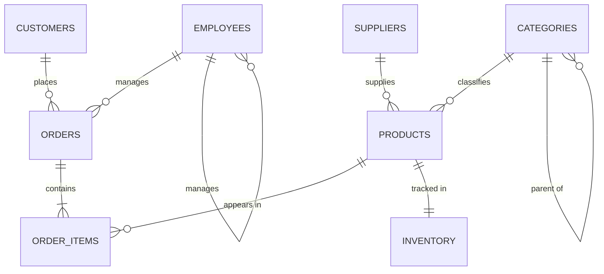
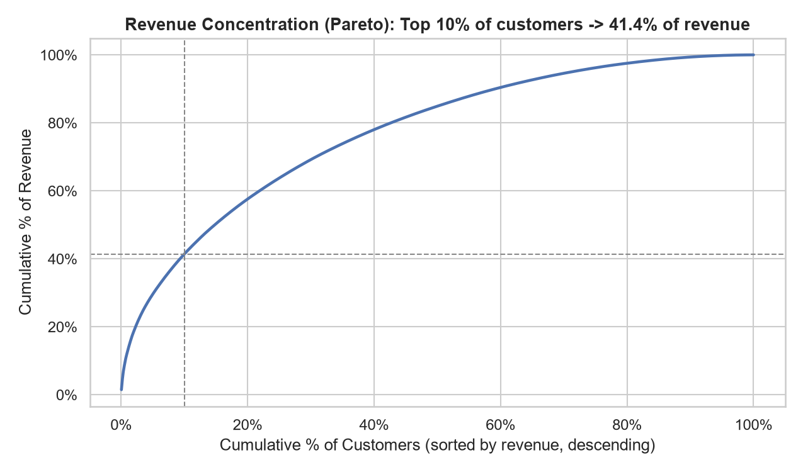
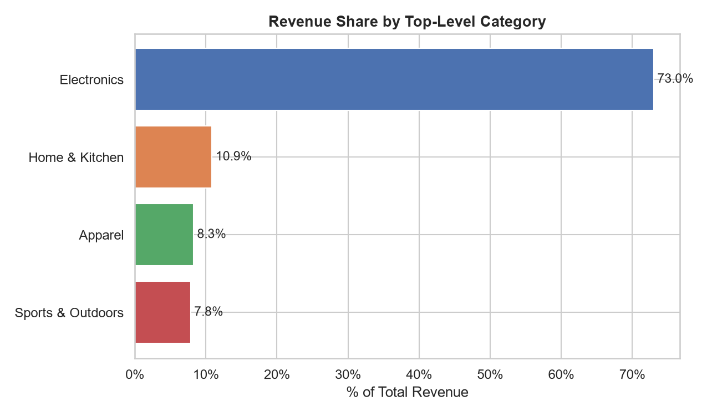
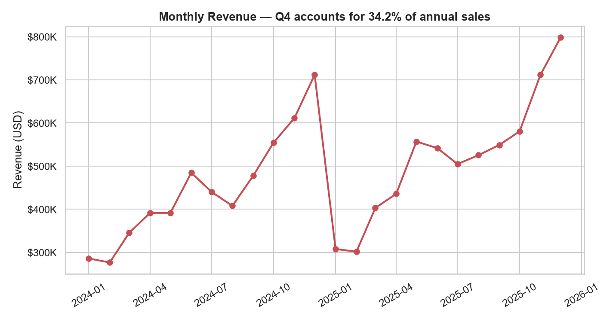
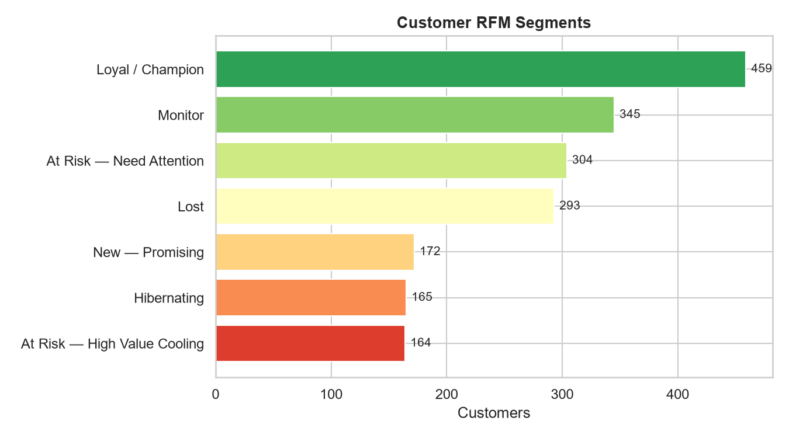
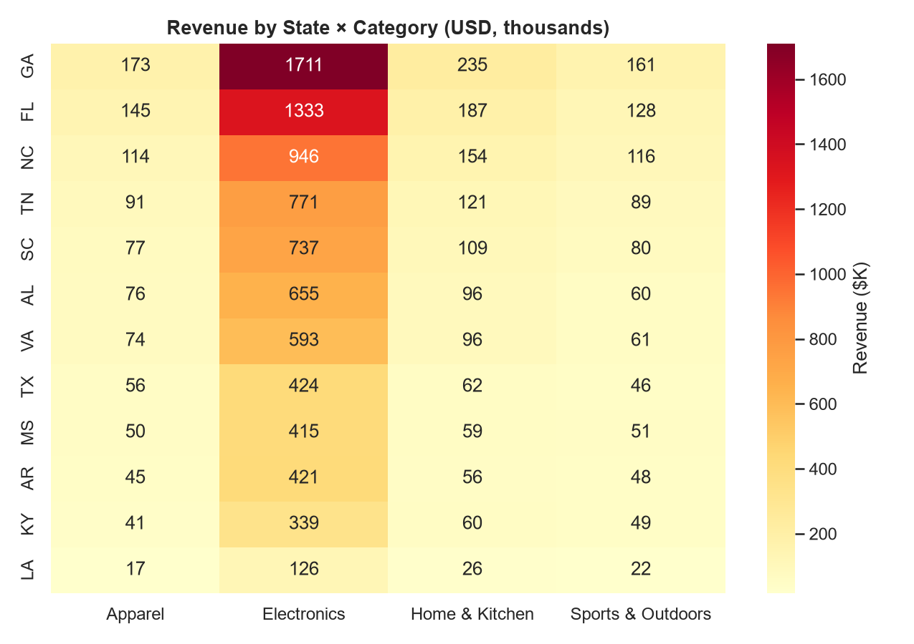
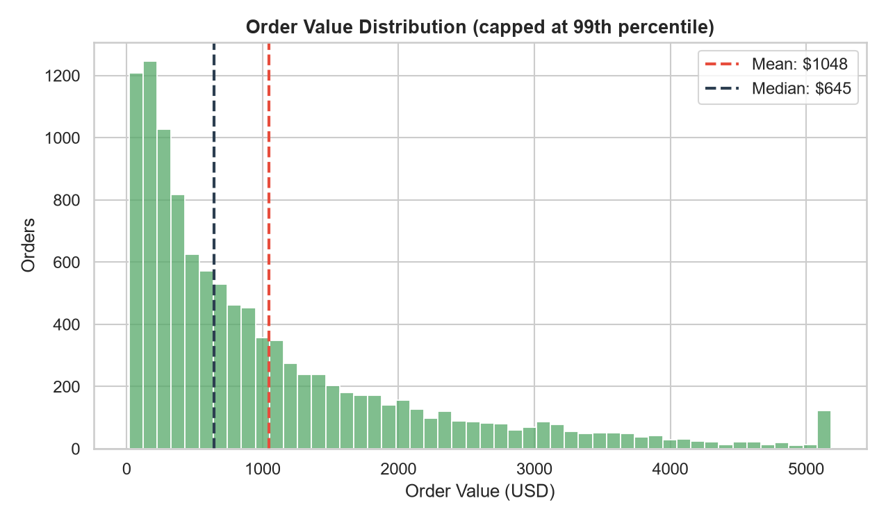

# RetailPulse — SQL Analytics Database

[](https://github.com/AwpDemon/retail-sql-analytics/actions/workflows/analysis.yml)
[](LICENSE)


> **Synthetic data.** All customers, orders and products are generated (`analysis/run_analytics.py`,
> `scripts/generate_data.py`, `schema/04_seed_data.sql`). Every number below is computed by a script in this
> repo; `analysis/findings.md` is generated from `analysis/outputs/metrics.json`, and a test fails if the
> README disagrees with it.

**Highlights**
- 8-table 3NF PostgreSQL schema, 20 secondary indexes, 15 analytical queries (CLV deciles, cohort retention, cross-sell lift, RFM churn, seasonal patterns, geography). All 15 run in CI against PostgreSQL 16, along with 16 data-integrity SQL tests.
- DuckDB pipeline (2,000 customers, 12,000 orders): **top 10% of customers drive 41.4% of net revenue**, **Q4 = 34.2%** of annual revenue.
- Measured query tuning on 100k orders (PostgreSQL 16, `EXPLAIN ANALYZE`, median of 15): replacing correlated subqueries with one aggregation pass cut the RFM query **1,157 → 365 ms (-68%)** and the customer-revenue query **444 → 230 ms (-48%)** with identical results. Two other rewrites made things slower and are reported as such ([optimization report](docs/optimization_report.md)).

A relational e-commerce database in PostgreSQL with 15 analytical queries — customer segmentation, churn risk, cross-sell, cohort analysis, seasonal trends.

The one query I kept coming back to:

```sql
-- RFM churn risk: weight recency highest, classify, recommend action
WITH rfm_scored AS (
  SELECT
    c.customer_id,
    NTILE(5) OVER (ORDER BY MAX(o.order_date) ASC)         AS recency_score,  -- 5 = most recent
    NTILE(5) OVER (ORDER BY COUNT(o.order_id) ASC)         AS frequency_score, -- 5 = most orders
    NTILE(5) OVER (ORDER BY SUM(oi.quantity*oi.unit_price) ASC) AS monetary_score -- 5 = top spend
  FROM customers c
  JOIN orders o       ON o.customer_id = c.customer_id
  JOIN order_items oi ON oi.order_id   = o.order_id
  GROUP BY c.customer_id
)
SELECT customer_id,
  ROUND((recency_score*0.50 + frequency_score*0.30 + monetary_score*0.20)::NUMERIC, 2) AS rfm_score,
  CASE
    WHEN recency_score<=1 AND frequency_score<=2 THEN 'HIGH RISK — Lost'
    WHEN recency_score<=2 AND monetary_score>=4 THEN 'AT RISK — High Value Cooling'
    WHEN recency_score>=4 AND frequency_score>=4 THEN 'SAFE — Loyal'
    ELSE 'MODERATE — Monitor'
  END AS churn_label
FROM rfm_scored
ORDER BY rfm_score DESC;
```

Recency weighted heaviest because, for churn specifically, time-since-last-order predicts better than total spend does. A high-value customer who hasn't ordered in 200 days is worth chasing; a low-value customer who bought yesterday isn't. That's the "High Value Cooling" branch. Full query with engagement tiers and recommended actions in `queries/advanced/10_churn_prediction.sql`.

## Schema



8 tables, 3NF, self-referencing hierarchies on categories and employees. Full field-level diagram in [`docs/er_diagram.md`](docs/er_diagram.md).

## What's in `queries/`

- `basic/` — 5 queries: category revenue, customer orders, product sales, inventory status, employee performance
- `advanced/` — 10 queries: CLV deciles, cohort retention, cross-sell lift, churn RFM, seasonal patterns, geographic analysis, supplier performance
- `optimized/` — five before/after pairs, measured with `scripts/benchmark_optimizations.py`. See [`docs/optimization_report.md`](docs/optimization_report.md).

Findings summary in [`analysis/findings.md`](analysis/findings.md) (generated, synthetic data).

## Results

`analysis/run_analytics.py` loads synthetic data into DuckDB (same Postgres-compatible SQL) and renders the six charts I keep coming back to. 2,000 customers, 12,000 orders, ~24.6k line items.



The top 10% of customers drive 41.4% of net revenue. The generator draws customers with Pareto weights, so the concentration is built in; the point of the chart is the query and the reading, not a discovery.



Electronics is 73.0% of net revenue because laptops and phones are priced far above everything else. This pipeline has no product cost data, so it says nothing about margins (query `13_profit_margins.sql` computes margins on the Postgres seed data).



Q4 is 34.2% of annual revenue (Q1: 16.6%), following the month weights in the generator. A forecast without a seasonal term would miss most of this pattern.



Distribution across the RFM labels from the churn query (1,902 customers with revenue). 165 fall in "At Risk — High Value Cooling": recency in the middle quintile or older, monetary value in the top two quintiles. (An earlier version of this query had the NTILE directions inverted, so it labeled the most recent, most frequent customers as "Lost"; fixed in `10_churn_prediction.sql` and the pipeline.)



Revenue by state and category. The generator uses 12 Southern states with fixed weights and the same category mix everywhere, so differences between cells mostly reflect state size (GA is largest at 19.6%), not regional taste.



Right-skewed: mean order value $1,047.62 vs median $644.78, so summaries should lead with the median.

## Run it

```bash
# Postgres path — schema + seed
psql -f schema/01_create_tables.sql
psql -f schema/02_create_indexes.sql
psql -f schema/03_create_views.sql
psql -f schema/04_seed_data.sql

# Or, no-setup path — reproduces the six charts and metrics.json in DuckDB
pip install -r requirements.txt
python analysis/run_analytics.py
python analysis/write_findings.py   # regenerates analysis/findings.md
python -m pytest tests              # numbers in README/findings must match metrics.json
```

PostgreSQL 16 for the schema path (verified in CI); DuckDB 1.5 for the Python path.

## Limitations

- All data is synthetic, and the main patterns (Pareto concentration, Q4 peak) are built into the generator. The value here is the schema, SQL and method, not the business findings.
- Customer segment labels in the DuckDB pipeline are random, so segment comparisons carry no signal.
- `scripts/generate_data.py` prices line items independently of the product catalog, so margin and cross-sell queries on generated data are not meaningful; run them on the seed data.
- Benchmarks come from one machine and one container; absolute times will differ elsewhere.
